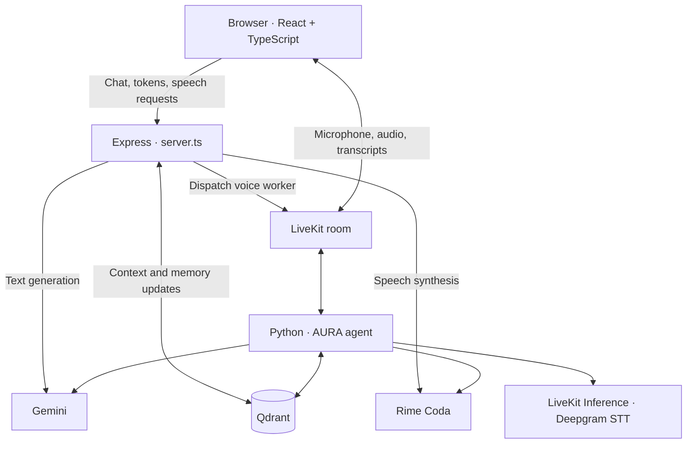

<h1 align="center">NEXIS · Starforge</h1>

<p align="center">
  <strong>AURA — an adaptive voice agent with workflow-aware memory.</strong><br>
  Talk through a food order, get appointment assistance, or follow a recipe one step at a time.
</p>

<p align="center">
  
  
  
  
  <a href="LICENSE"></a>
</p>

<p align="center">
  <a href="#overview">Overview</a> ·
  <a href="#experiences">Experiences</a> ·
  <a href="#architecture">Architecture</a> ·
  <a href="#run-locally">Run locally</a> ·
  <a href="#configuration">Configuration</a> ·
  <a href="#documentation">Documentation</a>
</p>

---

## Overview

NEXIS · Starforge is a voice-assistant demo built around **AURA**. It combines a React session interface, a Node/Express API, and a Python LiveKit worker to connect spoken conversations with workflow-specific context. The codebase also uses **Matrix Core** as its internal project name.

Gemini generates responses, Qdrant stores and retrieves contextual memories, and Rime provides speech output. The interface brings together transcripts, retrieved context, session timing, and a session summary, with animated Three.js visuals.

For example, in the food workflow, AURA can use a remembered vegetarian preference while helping assemble an order. In cooking mode, it can use recipe context to guide the next step. These are conversational demo workflows; the repository does not integrate restaurant checkout or appointment-booking systems.

## Experiences

| Experience | Conversation focus | Context used by the demo |
| --- | --- | --- |
| **Food ordering** | Build or modify a food order and confirm choices | Dietary preferences, previous orders, menu context, and unfinished order state |
| **Healthcare assistance** | Appointment-related help and general health information | Previous appointment requests and workflow safety instructions |
| **Home cooking** | Recipe guidance and substitutions | Food preferences and recipe progress |

The healthcare prompt limits AURA to general information and administrative help, excludes diagnosis and prescribing, and directs serious symptoms toward professional care.

## Architecture



**Text interaction:** the browser sends a message to `/api/chat`. Express retrieves user- and workflow-scoped memories, asks Gemini for a short response, and saves selected memory updates. `/api/tts` returns Rime audio for browser playback.

**Voice interaction:** the browser obtains a short-lived token, joins a LiveKit room, and publishes microphone audio. The Python worker uses speech recognition, Gemini, Qdrant, and Rime to respond through the room. Manual turn controls use the agent's `start_turn`, `end_turn`, and `cancel_turn` RPC methods.

Express serves both the frontend and API on port `3000`. The voice worker runs separately.

## Run locally

### 1. Install the web app

Use Node.js **22.12+**, npm, and Git. For the voice worker, use Python **3.10–3.14** and `uv` (the supported Python range is declared in `agent/pyproject.toml`).

```powershell
git clone https://github.com/Sarthaksulkhlan/Nexis---Starforge.git
cd Nexis---Starforge
npm ci
Copy-Item .env.example .env.local
```

On macOS or Linux, use `cp .env.example .env.local` for the copy step.

Edit `.env.local` with your service credentials using the [configuration table](#configuration). Keep credentials in the server environment; `.env.local` is excluded from Git.

### 2. Start the frontend and API

```powershell
npm run dev
```

Open **[http://localhost:3000](http://localhost:3000)**.

You can explore the interface without service credentials. To try fallback text responses, leave credential values unset instead of keeping the example placeholders. Live voice requires configured services and the worker below.

### 3. Start the voice worker

In a second terminal, from the repository root:

```powershell
cd agent
pip install uv
uv sync
uv run agent.py download-files
uv run agent.py dev
```

The worker loads the root `.env.local` when launched from `agent/`. Alternatively, use `agent/.env.example` as a template for `agent/.env`; root values loaded first take precedence. Use a LiveKit project with access to LiveKit Inference for the configured speech-recognition model.

Keep both terminals running, allow browser microphone access, choose an experience, and use the session's microphone controls. Microphone access requires localhost or HTTPS.

### 4. Try a conversation

1. Select **Food ordering** and ask, “Can you suggest a vegetarian dinner?”
2. Continue with “Make it spicy,” then inspect the transcript and retrieved context.
3. Switch to **Home cooking** and ask for help preparing a recipe.
4. End the session to review its summary and displayed memories.

Initial conversations and memories include seeded demo content. Responses depend on the configured services and available context.

## Configuration

The root [`.env.example`](.env.example) contains the web server settings; [`agent/.env.example`](agent/.env.example) contains the worker settings.

| Variable | Purpose |
| --- | --- |
| `GOOGLE_API_KEY` | Gemini credentials; the Node server also accepts `GEMINI_API_KEY` |
| `GEMINI_MODEL` | Model selection; the example configuration uses `gemini-2.5-flash` |
| `LIVEKIT_URL` | LiveKit WebSocket URL |
| `LIVEKIT_API_KEY`, `LIVEKIT_API_SECRET` | Server and worker credentials for LiveKit |
| `RIME_API_KEY` | Rime speech synthesis credentials |
| `RIME_MODEL_ID`, `RIME_SPEAKER` | Speech model and voice; example values are `coda` and `astra` |
| `RIME_API_URL`, `RIME_LANGUAGE` | Node speech endpoint and language settings |
| `QDRANT_URL` | Qdrant endpoint for contextual memory |
| `QDRANT_API_KEY` | Authentication for Qdrant deployments that require it |
| `QDRANT_COLLECTION` | Memory collection; defaults to `matrix_core_memory` |
| `PORT` | Web server port; defaults to `3000` |

## API

| Method | Endpoint | Purpose |
| --- | --- | --- |
| `GET` | `/api/health` | Report which service settings are present, without exposing secrets |
| `POST` | `/api/livekit/token` | Create a room token and dispatch the AURA voice worker |
| `POST` | `/api/chat` | Generate a workflow-aware response with retrieved context and timing data |
| `POST` | `/api/tts` | Convert text to base64-encoded speech audio |

`/api/health` checks configuration presence, not provider connectivity. LiveKit and Rime endpoints return errors when required configuration is missing. Text chat can return workflow-specific fallback responses when Gemini is unavailable.

## Development commands

| Command | Purpose |
| --- | --- |
| `npm run dev` | Start Express with Vite development middleware |
| `npm run lint` | Run TypeScript checking with `tsc --noEmit` |
| `npm run build` | Build frontend assets and bundle the Node server into `dist/` |
| `npm start` | Run `dist/server.cjs`; set `NODE_ENV=production` to serve built frontend assets |
| `npm run preview` | Preview the Vite frontend build; does not start the API |

To run a production build in PowerShell:

```powershell
npm run build
$env:NODE_ENV = "production"
npm start
```

On macOS or Linux, use `NODE_ENV=production npm start` after building. Voice sessions still require the separate Python worker.

## Repository layout

```text
src/
  App.tsx                 Experience selection and session state
  components/             Landing page, session studio, summaries, and visuals
  data/                   Experience definitions and seeded demo content
  types.ts                Shared frontend types
server.ts                 Express API and frontend serving
agent/
  agent.py                LiveKit voice worker and Qdrant memory integration
  pyproject.toml          Python dependencies and supported versions
backend/
  README.md               Backend setup notes; server code lives at the root
.env.example              Root configuration template
```

## Current scope

- This is a demo application. Initial transcripts, memories, and some interface metrics are seeded values, not measured performance claims.
- Memory retrieval uses deterministic 128-dimensional hash vectors, rather than a learned semantic embedding model.
- The browser uses the shared `demo-user` identity. User authentication and account isolation are not implemented.
- Session state and manual memory edits in the interface live in React state. They are separate from the backend's Qdrant memory writes and are not a persistent session archive.
- Food and healthcare workflows provide conversational assistance; they do not place real orders or book appointments.

## Documentation

| Resource | Contents |
| --- | --- |
| [Voice worker guide](agent/README.md) | Python setup and LiveKit interaction details |
| [Backend guide](backend/README.md) | Root server setup and endpoint overview |
| [Web configuration](.env.example) | Server environment template |
| [Worker configuration](agent/.env.example) | Voice agent environment template |

## License

MIT License. Copyright © 2026 Sarthak Sulkhlan. See [LICENSE](LICENSE).
