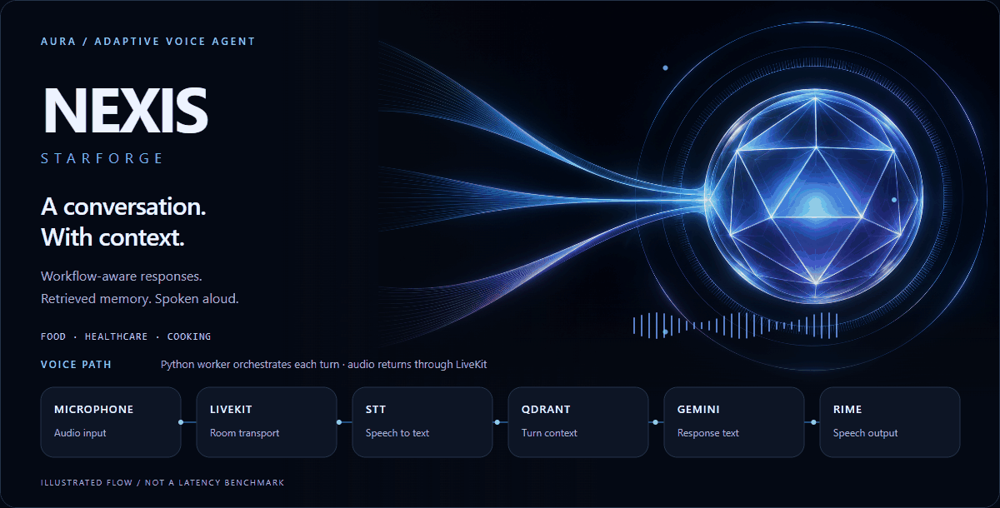
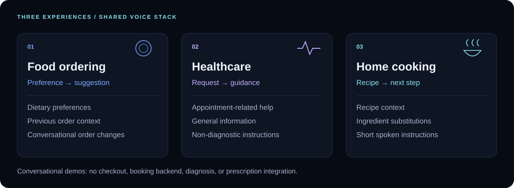
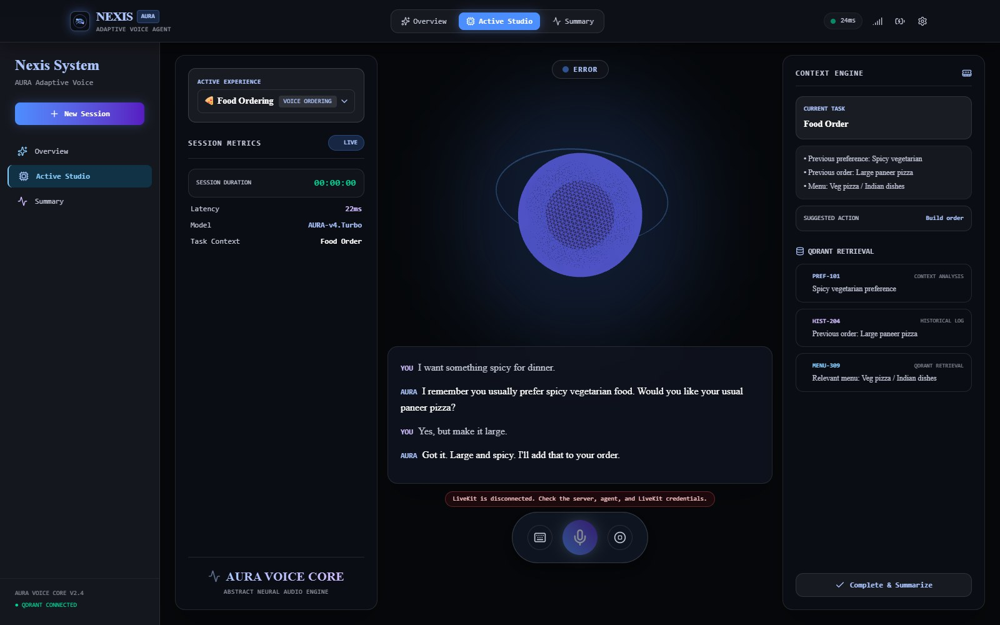
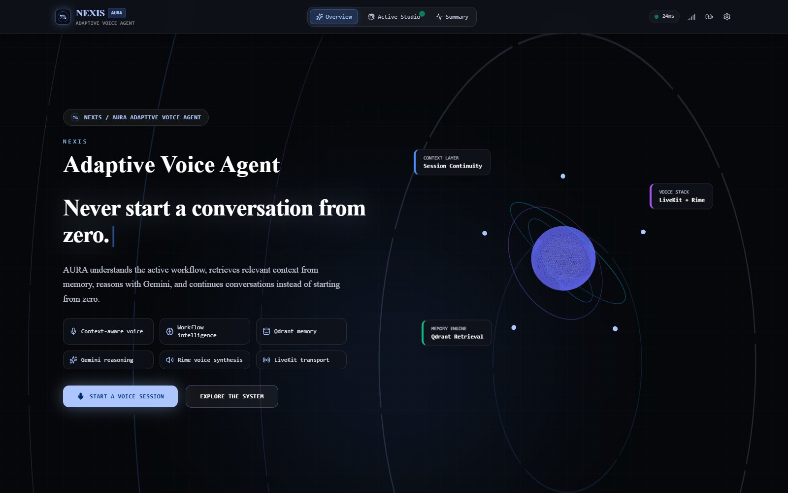
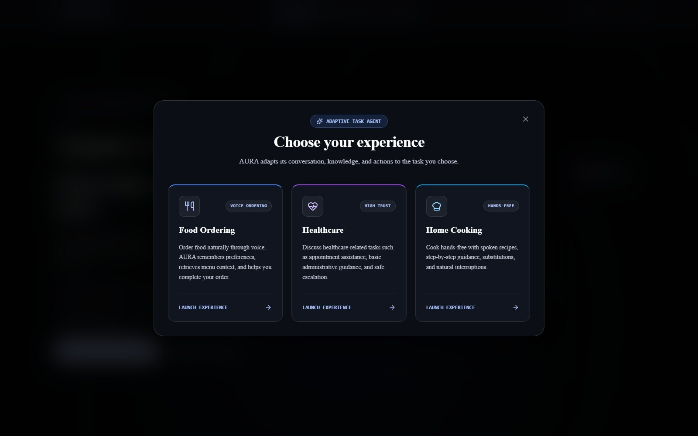
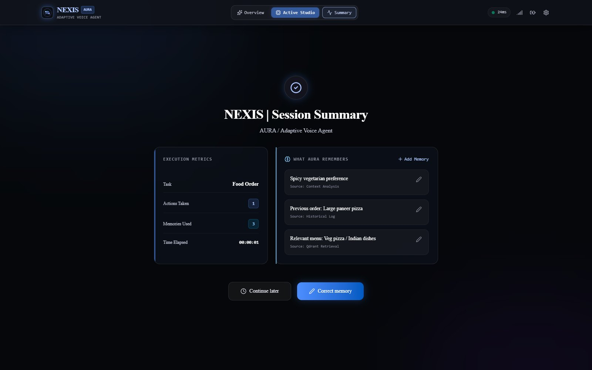
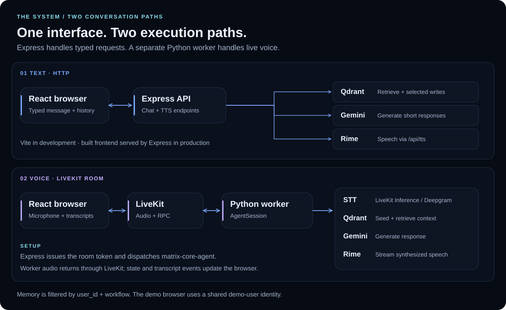
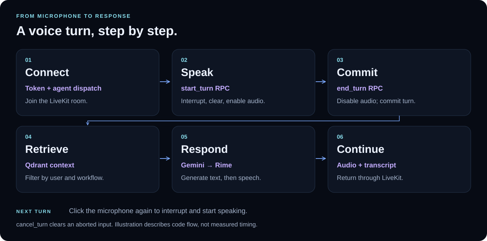

<p align="center">
  
</p>

<h1 align="center">NEXIS · Starforge</h1>
<p align="center"><strong>A conversation. With context.</strong><br>AURA brings workflow-aware responses, retrieved memory, and spoken interaction into one session.</p>

<p align="center">
  
  
  
  <a href="LICENSE"></a>
</p>

<p align="center">
  <a href="#experience">Experience</a> &nbsp; · &nbsp;
  <a href="#inside-the-product">Screenshots</a> &nbsp; · &nbsp;
  <a href="#architecture">Architecture</a> &nbsp; · &nbsp;
  <a href="#quick-start">Quick start</a> &nbsp; · &nbsp;
  <a href="#development">Development</a>
</p>
<p align="center"><sub>Voice-agent prototype · Original illustrated flow, not a performance benchmark · <a href="docs/assets/hero-poster.png">View the still hero</a></sub></p>

---

## Experience

**Choose a task. Bring in context. Keep the conversation moving.**

NEXIS is a React application with an Express API and a separate Python voice worker. Its assistant, **AURA**, uses Gemini for text generation, Qdrant for contextual memory, LiveKit for real-time transport, and Rime for speech synthesis. The source also uses **Matrix Core** as its internal project name.

The three implemented experiences change the assistant's prompts and context. They provide conversational help; they do not execute restaurant purchases or book real appointments.



| Capability | What is implemented |
| --- | --- |
| **Controlled voice turns** | Click to speak, click again to commit the turn, and start another turn to interrupt AURA. The worker exposes `start_turn`, `end_turn`, and `cancel_turn` RPCs. |
| **Context before the response** | Both execution paths query Qdrant with `user_id` and `workflow` filters. The voice worker injects retrieved context before Gemini responds. |
| **Typed conversation** | A keyboard input sends recent conversation history to `/api/chat`. Rime playback is attempted when the browser is not connected to LiveKit. |
| **Visible session state** | A Three.js orb, transcripts, a session timer, and voice-state events accompany the conversation. The studio's context cards display seeded experience data. |
| **Session review** | The summary shows session values and memories, with controls to add or edit memories in browser state. These edits do not write to Qdrant. |

Healthcare prompts restrict responses to administrative help and general information, exclude diagnosis and prescribing, and direct serious symptoms toward professional care.

## Inside the product

**Actual application captures, not mockups.** These screenshots were taken from the unmodified local app without provider credentials. Transcripts and context cards are seeded demo content. The visible LiveKit error is expected; static latency, model, and “Qdrant connected” labels do not establish service health.

<a href="docs/assets/app-studio.jpg"></a>

<p align="center"><sub>Active Studio · Food ordering · Credential-free demo state</sub></p>

<details>
<summary><strong>Explore the landing page, experience selector, and session summary</strong></summary>

### The entry point



### Choose a workflow



### Review the session



</details>

## Architecture

**Two execution paths share the same service stack.** Express serves the web application and HTTP endpoints. The Python worker runs independently and joins LiveKit rooms dispatched by Express.



| Layer | Technologies | Responsibility |
| --- | --- | --- |
| Interface | React 19, TypeScript, Tailwind CSS 4, Lucide | Experience selection, session controls, transcripts, and summaries |
| Visuals | Three.js | Core geometry, orbital rings, and listening/speaking visualization |
| Web runtime | Express 4, Vite 6, tsx, esbuild | API routes, development middleware, and production frontend serving |
| Voice worker | Python, LiveKit Agents, Silero, LiveKit noise cancellation | Room participation, manual turn control, speech input, and streamed audio |
| Recognition | Deepgram Nova-3 through LiveKit Inference | Voice-to-text transcription |
| Generation | Google Gen AI SDK / LiveKit Google plugin | Workflow-aware Gemini responses |
| Speech | Rime Coda | HTTP synthesis for typed responses; WebSocket synthesis in the worker |
| Memory | Qdrant over HTTP | Seeded context, filtered retrieval, and selected writes from text chat |

### Memory, precisely

Both backends build **128-dimensional deterministic hash vectors** and use cosine search with a maximum of four retrieved memories. This is lightweight vector retrieval, not a learned semantic embedding model.

The Node text endpoint saves selected food preferences, order state, and cooking context using keyword rules. The voice worker seeds and retrieves demo memories; it does not extract and save new conversational facts. Manual summary edits remain in React state. The browser currently sends a shared `demo-user` identity.

## A voice turn



The worker sends `aura_ready`, voice-state, and conversation events back to the browser. Starting a new turn interrupts current output and clears the previous input buffer. `cancel_turn` clears an aborted input.

The separate **text path** is: typed message → `/api/chat` → memory retrieval → Gemini (or a fallback response) → selected memory writes → browser transcript. When LiveKit is disconnected, the browser also requests `/api/tts` for playback.

## Quick start

### 01 · Start the web application

Use **Node.js 22.12+**, npm, and Git. The voice worker additionally requires **Python 3.10–3.14** and `uv`.

```powershell
git clone https://github.com/Sarthaksulkhlan/Nexis---Starforge.git
cd Nexis---Starforge
npm ci
Copy-Item .env.example .env.local
```

On macOS or Linux, replace the last command with `cp .env.example .env.local`.

Fill in `.env.local` using the service settings below, then run:

```powershell
npm run dev
```

Open **[localhost:3000](http://localhost:3000)**. Frontend and API use the same port.

**Just exploring the interface?** You can run without credentials. Leave credential fields unset or empty instead of retaining placeholder strings. Text chat has fallback responses; live voice and synthesized speech require their providers. The studio displays a voice connection error until LiveKit and the worker are available.

### 02 · Configure services

| Settings | Used for |
| --- | --- |
| `GOOGLE_API_KEY` | Gemini access; the Node server also accepts `GEMINI_API_KEY` |
| `GEMINI_MODEL` | Model selection; both example files specify `gemini-2.5-flash` |
| `LIVEKIT_URL`, `LIVEKIT_API_KEY`, `LIVEKIT_API_SECRET` | LiveKit room access, token creation, and worker dispatch |
| `RIME_API_KEY` | Speech synthesis |
| `QDRANT_URL`, `QDRANT_API_KEY` | Memory service; the key is needed when the deployment requires authentication |

Keep credentials server-side. `.env.local` and the worker's `.env` are ignored by Git.

<details>
<summary><strong>Optional settings and configuration behavior</strong></summary>

| Setting | Behavior |
| --- | --- |
| `PORT` | Express port; defaults to `3000` |
| `QDRANT_COLLECTION` | Defaults to `matrix_core_memory` |
| `RIME_MODEL_ID`, `RIME_SPEAKER` | Default speech model and speaker: `coda`, `astra` |
| `RIME_API_URL`, `RIME_LANGUAGE` | Node HTTP synthesis endpoint and language |
| `RIME_SAMPLE_RATE` | Python audio sample rate; defaults to `24000` |
| `GEMINI_FALLBACK_MODEL` | Node retries this model; Python uses it only when `GEMINI_MODEL` is unset |
| `LIVEKIT_AGENT_NAME` | Node dispatch target; keep the default `matrix-core-agent` to match the worker |

Use an accessible model for your account. Model identifiers in the source are configuration defaults, not a guarantee of provider availability.

Express loads `.env.local`, then `.env`. Launched from `agent/`, the worker loads `../.env.local`, `../.env`, then its local `.env`; existing values take precedence. `APP_URL` is present in the template but is not read by the current server.

Templates: [web server](.env.example) · [voice worker](agent/.env.example).

</details>

### 03 · Start the voice worker

In a second terminal, from the repository root:

```powershell
cd agent
pip install uv
uv sync
uv run agent.py download-files
uv run agent.py dev
```

Use a LiveKit project with access to LiveKit Inference for the configured STT model. Keep both processes running. Allow microphone access and use localhost or HTTPS.

### 04 · Try a session

1. Select **Start a Voice Session**, then choose an experience.
2. Wait for **AGENT READY**, click the microphone, and speak. Click again to submit the turn.
3. In Food Ordering, try “Can you suggest a vegetarian dinner?” and follow with “Make it spicy.”
4. Use **Toggle Text Input** to try typed chat, or switch to Home Cooking for recipe guidance.
5. Choose **Finish & View Summary** to inspect the session. Memory edits here are local to the current page state.

<details>
<summary><strong>Troubleshooting and API reference</strong></summary>

| Symptom | Check |
| --- | --- |
| LiveKit token unavailable | Root LiveKit credentials, the running Python worker, and matching `matrix-core-agent` dispatch name |
| Connected, waiting for AURA | Worker logs, LiveKit project access, and worker service credentials |
| Microphone unavailable | Browser permission and a localhost/HTTPS origin |
| Typed response has no audio | Rime credentials; typed-response synthesis is skipped while LiveKit is connected |
| Empty retrieval | Qdrant URL, authentication, collection access, and server/worker logs |

| Method | Route | Result |
| --- | --- | --- |
| `GET` | `/api/health` | Service configuration-presence flags; does not test connectivity |
| `POST` | `/api/livekit/token` | Short-lived token, room, identity, workflow, and worker dispatch |
| `POST` | `/api/chat` | Response text, retrieved context, and request timing |
| `POST` | `/api/tts` | Base64-encoded audio and synthesis metadata |

Missing LiveKit or Rime configuration produces errors from those endpoints. Gemini failures can produce workflow-specific text fallbacks. Qdrant retrieval failures are logged and can fall back to no retrieved memory.

</details>

## Development

| Command | Purpose |
| --- | --- |
| `npm run dev` | Express + Vite development middleware |
| `npm run lint` | TypeScript checking (`tsc --noEmit`) |
| `npm run build` | Frontend build + bundled Node server in `dist/` |
| `npm start` | Run the bundled server; set `NODE_ENV=production` to serve built frontend assets |
| `npm run preview` | Vite frontend preview only; does not run the API |

Production build in PowerShell:

```powershell
npm run build
$env:NODE_ENV = "production"
npm start
```

On macOS/Linux, use `NODE_ENV=production npm start` after building. Live voice still needs the Python worker.

### Project structure

```text
Nexis---Starforge/
├── src/
│   ├── App.tsx                 Three active views and browser session state
│   ├── components/             Landing, studio, summary, controls, 3D visuals
│   ├── data/experienceData.ts   Three workflow definitions and demo content
│   └── types.ts                Session, memory, experience, and voice-state types
├── server.ts                   Express routes, provider calls, memory helpers
├── agent/
│   ├── agent.py                LiveKit worker and turn-context retrieval
│   ├── pyproject.toml          Python dependencies and version range
│   └── uv.lock                 Python dependency lockfile
├── backend/                    Setup notes; executable server is at the root
├── docs/
│   ├── assets/                 Hero GIF, SVG diagrams, real app screenshots
│   └── design/                 Asset builders, provenance, verification notes
├── .env.example                Server configuration template
└── package.json                Web dependencies and scripts
```

### Scope and contribution

This is a prototype with seeded conversations and some static interface indicators. It has no user authentication, persistent session archive, order checkout, or appointment-booking integration. Archive and vault components exist in the source but are not connected to the active view router. There is no application test suite or CI workflow in this snapshot.

Contributions can address these concrete gaps: authenticating users, persisting sessions, connecting summary edits to memory storage, replacing static status indicators with measured state, and adding integration tests. These are **possible next steps**, not shipped features or a committed roadmap.

For a contribution, describe the problem in an [issue](https://github.com/Sarthaksulkhlan/Nexis---Starforge/issues), make a focused change, run `npm run lint` and `npm run build`, and include relevant manual verification in your pull request. For voice changes, verify a session against configured providers. Never commit credentials.

## Documentation

| Guide | What it covers |
| --- | --- |
| [Voice worker](agent/README.md) | Python setup and LiveKit interaction |
| [Backend](backend/README.md) | Root server and endpoints |
| [Visual provenance and reproduction](docs/design/README.md) | Original illustration, screenshot capture, diagram source mapping, GIF generation, and verification |

---

<p align="center"><strong>NEXIS · Starforge</strong><br><sub>AURA / Adaptive Voice Agent</sub></p>
<p align="center"><sub>Created by Sarthak Sulkhlan · <a href="LICENSE">MIT License</a> · Copyright © 2026</sub></p>
